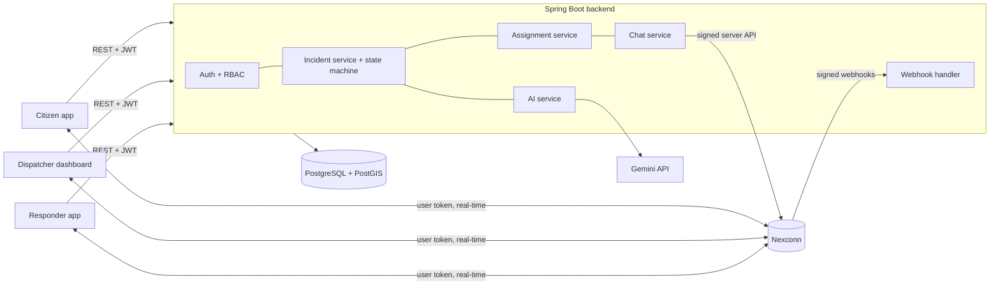

# ResQLink architecture

## Key decisions

| Decision | Why |
|---|---|
| Domain logic in `com.resqlink.core` with no framework imports | State machine, duplicate scoring, ranking, schema validation and signature checks are unit-tested without a database or Spring. |
| AI output validated against a strict schema, with a labelled rule-based fallback | Malformed model output is never stored; the app keeps working without a model and says so (`modelVersion`). |
| AI never changes an incident beyond a provisional priority | Dispatchers verify. Assignment is refused until `VERIFIED`. |
| Nexconn is the only message path | The backend stores channel references and counters, never message text. |
| Assignments hold a partial unique index | Duplicate live assignments are impossible even under concurrent requests. |
| Optimistic locking on incidents | Two dispatchers cannot silently overwrite each other. |
| Geography column maintained by a database trigger | Application code only handles lat/lng; PostGIS handles `ST_DWithin` and the GiST index. |
| Responder location is opt-in and deleted when sharing stops | Privacy by default. |

## Incident lifecycle

`REPORTED → AI_ANALYZED → AWAITING_VERIFICATION → VERIFIED → ASSIGNED → RESPONDER_ACCEPTED → ON_SCENE → RESOLVED → CLOSED`, with `REJECTED` and `DUPLICATE` as dispatcher exits before assignment. Every transition is validated by `IncidentStatus` and written to `incident_status_history`.

## AI modules

1. **Understanding** – Gemini (structured JSON, any input language, English output) → summary, category, priority, missing-information questions.
2. **Duplicates** – PostGIS proximity + time window, then distance/time/category/text scoring; Gemini embeddings (cosine) are blended in when available. Suggestions only.
3. **Response recommendation** – transparent score from distance, responder type fit and workload.
4. **Conversation summary** – summarises only messages supplied by an authorised dispatcher's client.

## Real-time model

| Data | Mechanism | Why |
|---|---|---|
| Chat messages, history, receipts | Nexconn SDK | Nexconn is the messaging system |
| Incident, assignment, responder, notification and channel changes | Server-Sent Events carrying **hints only** | Clients re-read state from REST, so duplicate, reordered or missed events cannot leave stale data |
| Fallback | React Query polling every 8–30 s | Covers missed hints and multi-instance deployments |

The header badge shows Live / Reconnecting / Offline and never claims "Live" unless the stream is connected.

## Chat channel synchronisation

Assignment (database transaction) → writes channel row `PENDING` and publishes an event → after commit a worker runs the Nexconn calls
(issue tokens, create group, join) **outside any transaction** → records `SYNCED` or `FAILED` with an error and exponential backoff
(10 s … 5 min, 8 automatic attempts) → a scheduled job retries due channels; dispatchers can retry manually. A chat outage therefore cannot fail or corrupt an assignment, and failures stay visible.

## Security-relevant structure

Auth filter checks `status` and `token_version` against the database per request. Rate limits, webhook nonces and idempotency keys are PostgreSQL tables shared by all instances. The audit log is hash-chained. Evidence goes through `ImageSanitizer` into a private `BlobStore`.

## Nexconn flow

1. Login → backend issues a JWT.
2. `POST /chat/token` → backend registers the user via `/v4/auth/access-token/issue` and returns the user token and App Key (never the secret).
3. The browser lazily loads `@nexconn/chat`, initialises and connects.
4. Assigning a responder creates/joins group channel `resqlink_incident_RL<number>` through `/v4/group-channel/*`.
5. Messages, history, attachments and read receipts run through the SDK.
6. Webhooks (`SHA-1(secret+nonce+timestamp)`, 5-minute replay window) update channel activity and notify participants.
